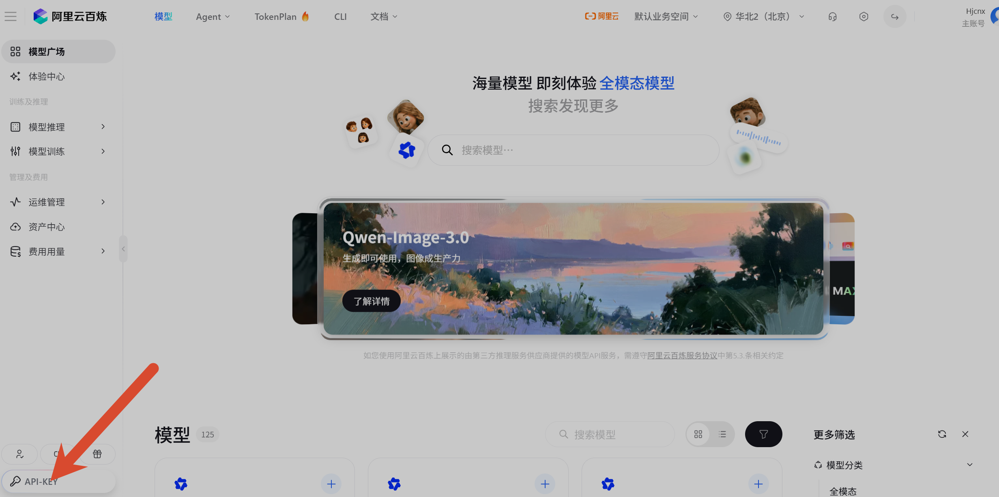
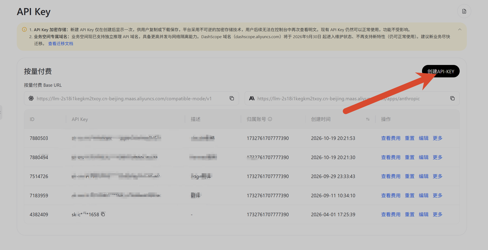

## 前言

相信大家也都领到阿里云送的 300 元代金券了，正好拿来给大模型 API 付费——本篇面向小白，手把手演示怎么在阿里云百炼上申请 API Key，并下载 Hermes 接入使用。全程大概 10 分钟。

## 第一步：进入百炼模型广场

打开阿里云百炼的模型市场页面：

> https://bailian.console.aliyun.com/cn-beijing/model/market

用阿里云账号登录后即可看到模型广场，里面有 125+ 个模型（Qwen 系列等），后面调 API 用的就是这里的模型。

## 第二步：创建 API Key

进入页面后，点左下角的「**API-KEY**」按钮：

进入 API Key 管理页后，点右上角的「**创建 API-KEY**」：

创建成功后会得到一串以 `sk-` 开头的 Key。这里有两件事必须注意：

1. **Key 只在创建成功后显示一次**（阿里云是加密存储的，之后无法再查看明文），弹出窗口时第一时间复制保存；
2. **Key 等同于钱包**——拿到它的人都能用你的代金券。别发群里、别上传公开仓库，发截图记得打码。

另外在这一页还能看到两条 **Base URL**（OpenAI 兼容格式和 Anthropic 兼容格式），后面在 Hermes 里配置时除了 Key 还要用到，一并复制保存。

## 第三步：下载 Hermes

先简单介绍一下 Hermes：对个人用户来说，它就像一个**「越用越懂你、还特别省钱的私人助理」**。

它最大的优点是**会自己学习进化**：你教它做一件事，它不仅会记住，还会自己总结经验，下次不用你废话它就能办妥，甚至能自己给自己写个小工具来干活。其次，它的**记性特别聪明**：只记关键信息、不记流水账，用得越久反而越省钱（Token）。最后，它**极其好养活**：不用花钱买昂贵的云服务，一台几十块的便宜小服务器就能让它 24 小时打工，还可以直接在微信或 Telegram 里给它派活。

安装包不到 8 MB，点下面的按钮就能下载：

<a class="btn btn-primary" href="https://hermes-assets.nousresearch.com/Hermes-Setup.exe?build=f3b5b980d615" download>下载 Hermes 安装包（约 8 MB）</a>

安装包托管在海外服务器，如果下载慢或者失败，可能需要梯子；也可以直接去 Nous Research 官网（nousresearch.com）获取最新版。

## 第四步：把 Key 配置进 Hermes

装好后打开 Hermes 的设置，找到模型服务商相关选项，把上面保存的 **API Key** 和 **Base URL** 粘贴进去，选一个模型（比如 Qwen 系列）就可以开始对话了。

到这里，恭喜你拥有了一个自己养起来的 AI 助理。后续我在使用中踩到什么坑、折腾出什么新玩法，都会继续更新在这篇教程里。
